# LASCA

[](https://react.dev/)
[](https://vitejs.dev/)
[](https://flask.palletsprojects.com/)
[](https://www.python.org/)
[](LICENSE)
[]()

LASCA is a desktop-oriented surveying and geodetic computation platform for field and office workflows. It combines a modern React interface with a Python and Flask backend to manage survey projects, compute measurements, generate engineering reports, and export CAD and PDF outputs for common geodetic tasks.

## Overview

LASCA is designed for surveyors, civil engineers, and technical teams working with horizontal and vertical control, station observations, coordinate calculations, and project-based data management. The application supports both manual data entry and Excel-driven workflows while persisting project state locally so each job remains organized and reproducible.

The system is structured around a project-centric workflow:

- Create and manage survey projects with metadata and stored observations.
- Perform calculations for traverse, leveling, goniometry, trigonometric height, tachymetry, and stakeout.
- Visualize computed geometry through charts, coordinate plots, and map overlays.
- Export results to PDF, DXF, and image formats when supported by each module.
- Package the application as a desktop Windows release using PyInstaller and Inno Setup.

## Key Features

###  Μετρήσεις Σταθμού

####  Angular Measurements (Γωνιομετρήσεις)

Process station observations to derive horizontal and zenith angles. The measurement workflow organizes readings by station, target, period, and instrument face.

- Review horizontal and zenith observations in structured tables.
- Run angle calculations and export a PDF report.
- Work with project measurement data loaded into LASCA.

<p align="center">
  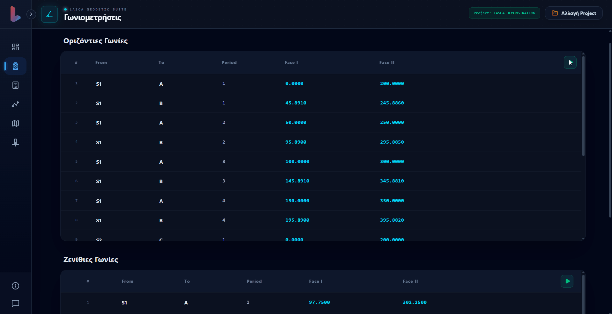
</p>

####  Network Adjustment (Συνόρθωση Σταθμού)

Support vertical control workflows with geometric leveling and station-observation adjustment. LASCA provides a table-based calculation flow and network visualization for reviewing observations and results.

- Calculate geometric leveling runs, including forward and return runs.
- Adjust station observations and inspect network quality in the interactive preview.
- Export supported adjustment results as a PDF report.

<p align="center">
  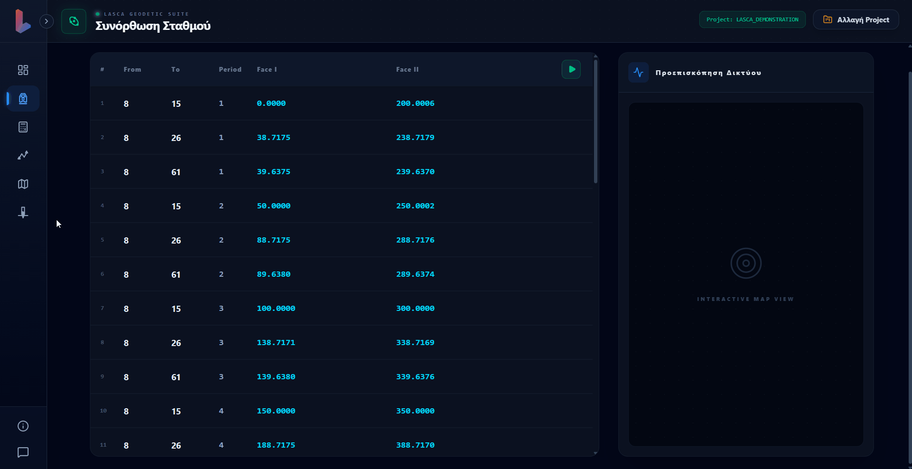
</p>

####  Trigonometric Leveling (Τριγωνομετρική Υψομετρία)

Compute height differences from slope-distance and zenith-angle observations, with instrument and target heights included in the calculation. Results are presented station-by-station for review.

- Enter or review distances, zenith angles, and station/target heights.
- Calculate height results and generate a PDF report.

<p align="center">
  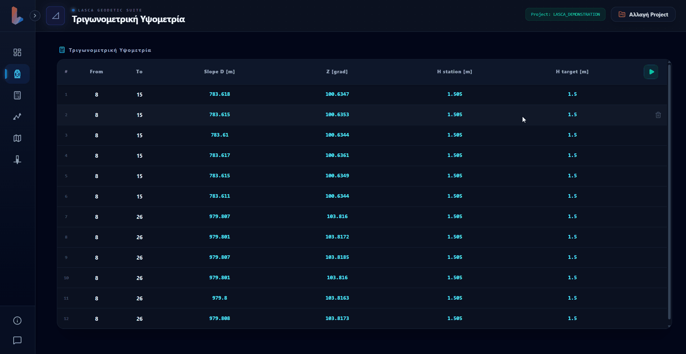
</p>

###  Leveling / Χωροστάθμη

Perform geometric leveling calculations, line reductions, and height difference determinations:

- **Geometric Leveling:** Calculate point elevations and line closures from backsight and foresight rod readings.
- **Error Distribution:** Compute and distribute misclosure errors across leveling loops.
- **Data Export:** Generate detailed leveling reduction sheets and summaries.

<p align="center">
  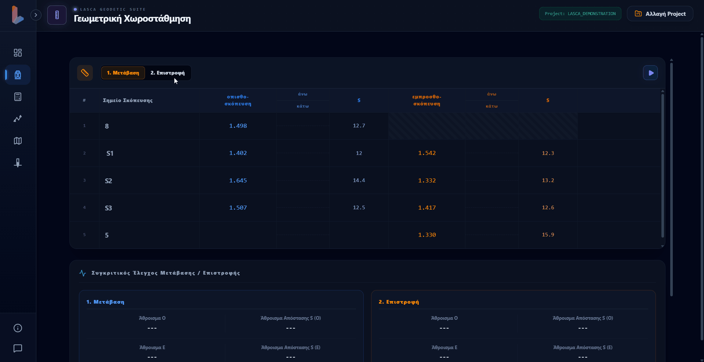
</p>

###  Basic Calculations - Βασικοί Τοπογραφικοί Υπολογισμοί

####  Μετατροπές Γωνιών

<p align="center">
  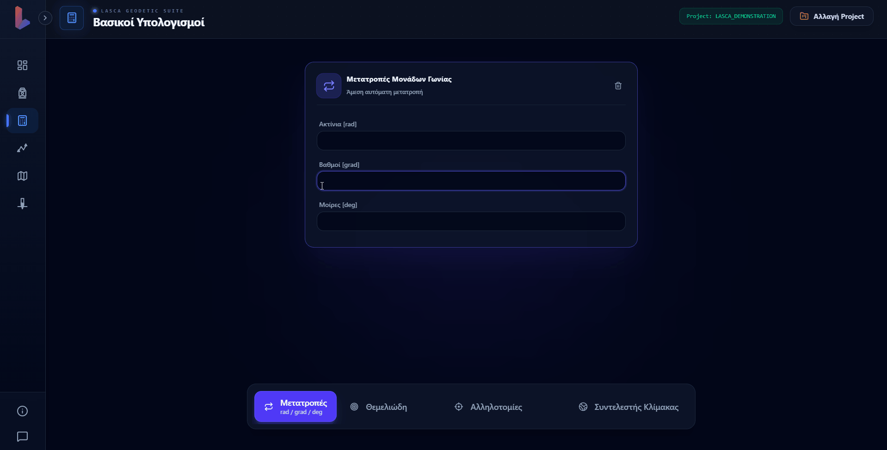
</p>

####  Θεμελιώδη Προβλήματα Τοπογραφίας

<p align="center">
  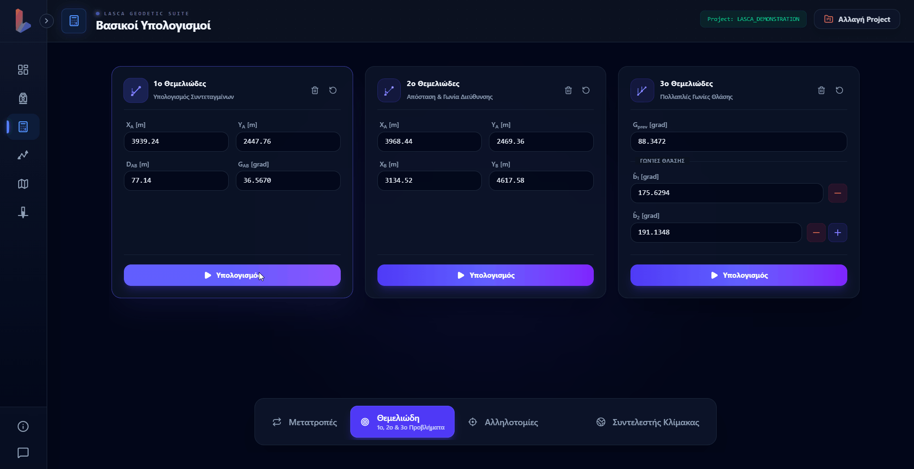
</p>

####  Resection & Intersection (Οπισθοτομία & Εμπροσθοτομία)

Determine unknown point coordinates from known control points and measured directions or distances. LASCA includes several solution methods for common resection and forward-intersection problems.

- Calculate resection solutions, including Collins and Tienstra methods.
- Solve forward intersections and review the resulting point geometry.
- Use intersection diagrams and generate supported calculation reports.

<p align="center">
  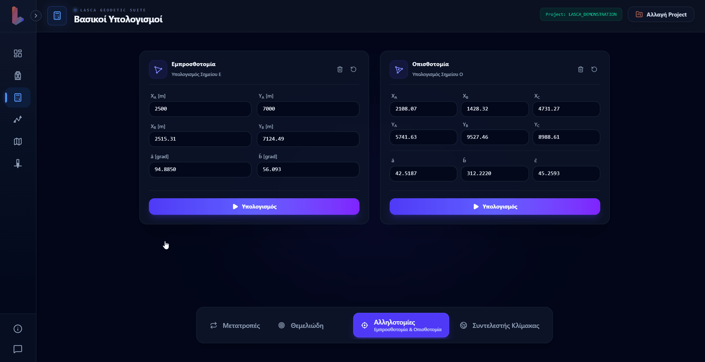
</p>

####  Συντελεστής Κλίμακας

<p align="center">
  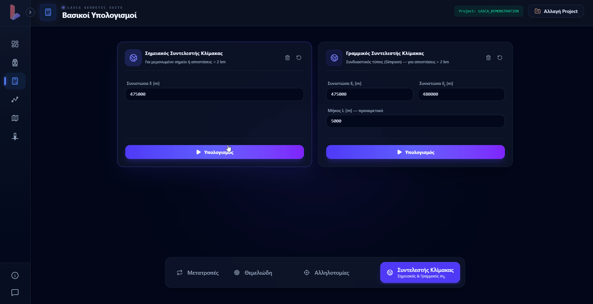
</p>

###  Traverse / Όδευση

LASCA supports complete traverse workflows for station observations, horizontal network computation, and vertical control. The module combines field measurements, coordinate propagation, and reporting in one structured environment.

<!-- <p align="center">
  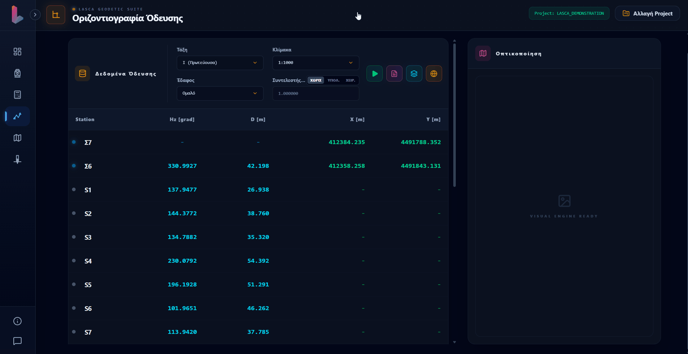
</p> -->

####  Οριζοντιογραφία (Planimetry / Horizontal Network)

Compute the horizontal geometry of a traverse network from observed directions and distances, then review the resulting coordinate system and network closure.

<p align="center">
  
</p>

####  Traverse Leveling / Υψομετρία Όδευσης

Perform trigonometric heighting along traverse lines, calculate vertical misclosures, and distribute height corrections:

- **Trigonometric Leveling:** Compute relative height differences $(\Delta H)$ using zenith angles and slope distances.
- **Vertical Closure:** Calculate vertical misclosure errors ($w_h$) across traverse legs.
- **Elevation Adjustment:** Automatically distribute height corrections based on distance or leg counts to determine final point elevations.

<p align="center">
  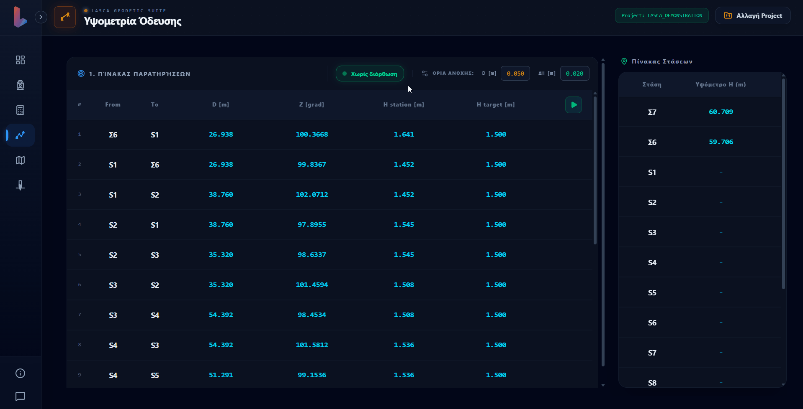
</p>

###  Mapping - Αποτύπωση

Turn station observations into mapped detail points for topographic survey work. The module combines measured data, coordinate computation, and a station sketch for spatial review.

- Process horizontal and vertical angles with slope distances.
- Calculate detail-point coordinates and apply supported scale-factor options.
- Inspect the station sketch and mapping visualization.

<p align="center">
  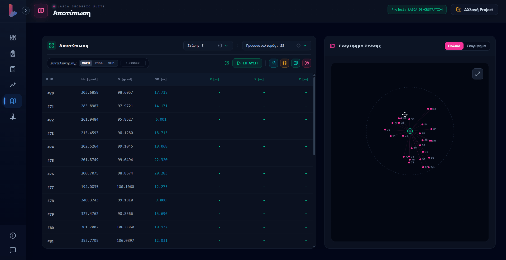
</p>

###  Stakeout - Χάραξη

Prepare known design points for field setting out from a selected station and orientation point. LASCA presents the point coordinates and an interactive sketch to support the layout workflow.

- Set the station and backsight coordinates.
- Enter stakeout point coordinates and run the calculation.
- Review the stakeout sketch and generate a PDF report.

<p align="center">
  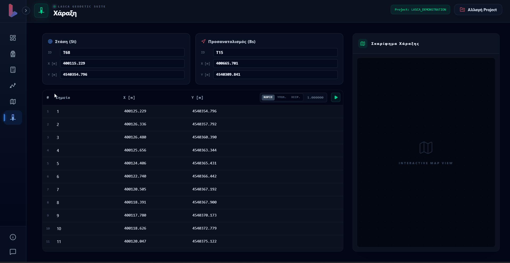
</p>

## Tech Stack

| Layer | Technologies | Notes |
| --- | --- | --- |
| Frontend | React 19, Vite 8, JavaScript/JSX | Main desktop-style UI and workflow navigation |
| Styling | Tailwind CSS 4, PostCSS, Autoprefixer | Layout and responsive styling |
| Visualization | Recharts, Leaflet, React Leaflet, proj4 | Charts, coordinate plots, and EPSG:2100 conversions |
| UI utilities | Axios, Lucide React, React Hot Toast, html2canvas | API access, icons, notifications, and screenshots |
| Spreadsheet and data | xlsx, xlsx-js-style | Excel templates and import/export support |
| Backend | Python 3.10+, Flask, Flask-CORS | Local API and calculation server |
| Surveying and analysis | NumPy, Pandas, SciPy, Matplotlib | Numerical processing and plotting |
| Report and CAD export | ReportLab, ezdxf | PDF and DXF generation |
| Desktop runtime | PyWebView | Embedded desktop application window |
| Packaging | PyInstaller, Inno Setup 6 | Windows executable and installer build |

## Prerequisites

Before running the project, ensure the following are installed:

- Node.js 18+ and npm
- Python 3.10 or newer
- Git
- A terminal such as PowerShell, Command Prompt, or Git Bash
- Windows 10+ recommended for the packaged desktop release

## Installation and Local Setup

### 1) Clone the repository

```bash
git clone https://github.com/<your-user>/<your-repo>.git
cd survey_project
```

### 2) Install frontend dependencies

```powershell
cd frontend
npm install
```

### 3) Create and activate a Python environment

```powershell
python -m venv .venv
.\.venv\Scripts\Activate.ps1
python -m pip install --upgrade pip
python -m pip install -r requirements.txt
```

### 4) Launch LASCA

```powershell
python main_for_app.py
```

This single entry point initializes the local server and starts the application in one process, so you do not need to run the backend and frontend in separate terminals.

## Production and Build

### Frontend build

```powershell
cd frontend
npm run build
```

This creates the production bundle in `frontend/dist`.

### Preview the production build

```powershell
cd frontend
npm run preview
```

### Lint the frontend

```powershell
cd frontend
npm run lint
```

### Windows desktop release

A full Windows packaging workflow is included in the repository:

```powershell
.\build_release.ps1
```

The script performs the following:

1. Builds the React frontend in `frontend`
2. Runs PyInstaller using `LASCA.spec`
3. Compiles the installer with Inno Setup 6
4. Produces the final installer in `installer-output\LASCA_Setup.exe`

> This release workflow expects a valid Python environment at `Lasca.venv\Scripts\python.exe` and an Inno Setup installation containing `ISCC.exe`.

## Project Structure

```text
survey_project/
├── LICENSE
├── README.md
├── requirements.txt
├── build_release.ps1
├── LASCA.spec
├── installer/
│   └── LASCA_Setup.iss
├── code/
│   ├── main_4_app.py
│   ├── main.py
│   ├── data_proccessing.py
│   ├── project_manager.py
│   ├── visualization.py
│   ├── vis_4_app.py
│   ├── configuration_settings.py
│   ├── assets/
│   └── feedback_uploads/
├── frontend/
│   ├── package.json
│   ├── vite.config.js
│   ├── tailwind.config.js
│   ├── index.html
│   ├── public/
│   └── src/
│       ├── App.jsx
│       ├── config.js
│       ├── main.jsx
│       ├── index.css
│       ├── components/
│       └── utils/
├── data/
├── dist/
├── installer-output/
├── Topo_Workspace/
└── LASCA/
```

## License

This project is distributed under the **LASCA Source-Available License**. Copyright (c) 2026 LASCA Team. Personal and educational use is permitted subject to the terms in the [LICENSE](LICENSE) file. Commercial Use and use to create or support Competing Products are strictly prohibited without prior written permission from the LASCA Team.

## Project Credits

LASCA was developed by students and contributors in the Surveying and Geomatics Engineering domain at Aristotle University of Thessaloniki (AUTH). The project credits the following contributors:

| Contributor | Profile |
| --- | --- |
| Alexandros Karachles | [GitHub](https://github.com/Neversplit2) |
| Ilias Saoulias | [GitHub](https://github.com/iliasaou) |
| Savvas Tsigou | [GitHub](https://github.com/Savvas-Tsigou) |
